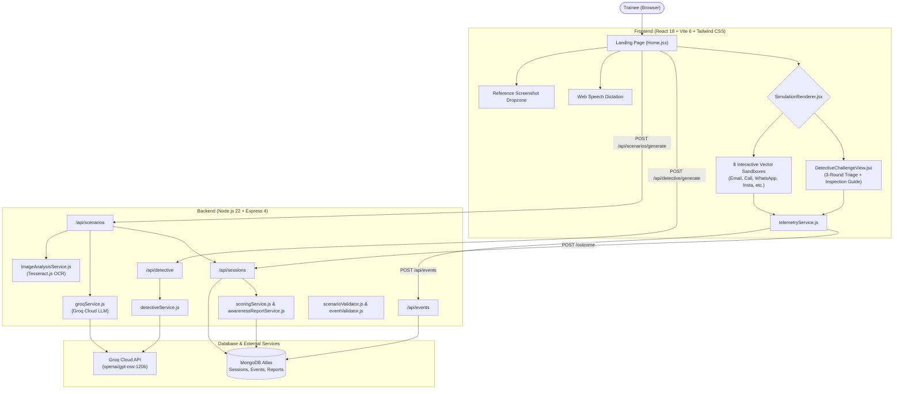
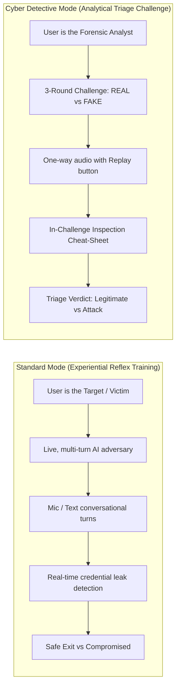

# AI-Driven Social Engineering Attack Simulation & Awareness Platform

[](https://nodejs.org/)
[](https://react.dev/)
[](https://vitejs.dev/)
[](https://tailwindcss.com/)
[](https://groq.com/)
[](https://www.mongodb.com/)
[-729B1B.svg)](https://vitest.dev/)

An enterprise-grade, full-stack cybersecurity training platform that replaces passive, quiz-based training with **generative, conversational, multi-channel attack simulations** and **forensic threat triage challenges**.

Powered by **Groq Cloud LLMs** and **Tesseract OCR**, the engine dynamically predicts attack vectors from natural-language descriptions or uploaded screenshots, generating hyper-realistic simulations inside pixel-accurate replicas of Gmail, WhatsApp, Instagram, Telegram, SMS, corporate SSO login portals, and telephone voice calls.

---

## Table of Contents
1. [Project Overview & Motivation](#1-project-overview--motivation)
2. [Key Capabilities & Features](#2-key-capabilities--features)
3. [End-to-End System Architecture](#3-end-to-end-system-architecture)
4. [The 8-Vector Attack Simulation Sandbox](#4-the-8-vector-attack-simulation-sandbox)
5. [Dual-Mode Simulation Methodology](#5-dual-mode-simulation-methodology)
6. [Multilingual AI & Indian Regional Localization](#6-multilingual-ai--indian-regional-localization)
7. [Real-Time Telemetry & Event Taxonomy](#7-real-time-telemetry--event-taxonomy)
8. [Behavioral Scoring & Awareness Reporting](#8-behavioral-scoring--awareness-reporting)
9. [Backend Deep Dive](#9-backend-deep-dive)
10. [Frontend Deep Dive](#10-frontend-deep-dive)
11. [Database Models & Schemas](#11-database-models--schemas)
12. [Installation & Getting Started](#12-installation--getting-started)
13. [Automated Verification & Testing](#13-automated-verification--testing)

---

## 1. Project Overview & Motivation

Traditional cybersecurity awareness suffers from a fundamental pedagogical flaw: **knowing what phishing is in theory does not translate into resisting it under active psychological stress**. Static questionnaires fail to build defensive reflexes against urgency, fear of account suspension, or authority impersonation.

Furthermore, real-world adversaries do not restrict themselves to corporate email. Modern social engineering relies heavily on cross-channel vectors:
* **Vishing (Voice Phishing):** Automated or live calls claiming fraudulent wire transfers.
* **Instant Messaging Scams:** Impersonation of CEOs, coworkers, or family on WhatsApp and Telegram.
* **Social Media Takeovers:** Fake copyright infringement notices via Instagram Direct Messages.
* **Counterfeit Portals:** Cloned Single Sign-On (SSO) login pages harvesting credentials and MFA codes.

This platform bridges this gap by creating **experiential, interactive simulation sandboxes** where users face realistic scenarios in safe environments, receive real-time pushback from adaptive AI personas, and obtain granular behavioral remediation.

---

## 2. Key Capabilities & Features

* **Autonomous Channel Prediction:** Groq LLMs analyze plain-text attack prompts across languages and automatically classify and dispatch the most realistic simulation vector (`email`, `call`, `whatsapp`, `instagram`, `telegram`, `sms`, `chat`, or `website`).
* **Multimodal OCR Vision Intelligence:** Users can upload up to 3 screenshots of real-world scam communications. Tesseract.js extracts visible text, domains, phone numbers, and threat indicators, enabling Groq to replicate the exact branding and scenario visually.
* **Live Interactive Voice Loop (Vishing):** Integrated Web Speech API (continuous Speech-to-Text with ~1.8-second silence debouncing) and Web Speech Synthesis (TTS). Includes a **Web Audio API DTMF dialpad** generating authentic telephone touch-tones with instant credit card/PIN leak detection.
* **Dual Pedagogical Modes:** 
  * **Standard Mode:** Experiential live defense as the target/victim under attack.
  * **Cyber Detective Mode:** Analytical 3-round forensic triage challenge assessing REAL vs FAKE communications.
* **"Golden Rule of Cybersecurity" Enforcement:** In Cyber Detective Mode, authentic (`REAL`) communications strictly strip all external URLs, directing users to bookmarked apps/portals independently.
* **Deep Regional Indian Language Localization:** Complete native Unicode script generation and phonetic speech recognition/synthesis for **Tamil, Telugu, Hindi, Kannada, Malayalam**, and **English**.
* **Real-Time Telemetry Pipeline:** Audits every keystroke, message expansion, link inspection, and voice turn to MongoDB.
* **Personalized Remediation & Instant Redo Loop:** Generates comprehensive risk scorecards ($0-100$), forensic breakdowns of missed red flags, and offers an immediate one-click redo option.

---

## 3. End-to-End System Architecture



### High-Level Directory Structure
```
ai-driven-social-engineering-platform/
├── backend/
│   ├── src/
│   │   ├── config/              # Attack taxonomy, DB connector, scoring weights
│   │   ├── models/              # Mongoose schemas (Session, SimulationEvent, etc.)
│   │   ├── routes/              # Express API routers (scenarios, detective, sessions, events)
│   │   ├── services/            # Groq AI, OCR, scoring, report, and outcome services
│   │   ├── validators/          # Scenario, contact name, and event validators
│   │   ├── app.js               # Express application initialization & middleware
│   │   └── server.js            # Server entrypoint & DB lifecycle listener
│   ├── test/                    # Backend Vitest integration test suites
│   ├── package.json
│   └── .env                     # Environment variables (Groq key, MongoDB URL)
│
├── frontend/
│   ├── src/
│   │   ├── components/
│   │   │   ├── common/          # Global Header, Navigation, Shared Modals
│   │   │   ├── detective/       # DetectiveChallengeView & DetectiveReportView
│   │   │   ├── report/          # AwarenessReportView (Post-session scorecard)
│   │   │   └── simulation/      # 8 Vector Simulators (Email, Call, WhatsApp, etc.)
│   │   ├── pages/               # Home (Landing), Simulations, Learn, History
│   │   ├── services/            # Telemetry dispatch client
│   │   ├── App.jsx              # Session coordinator & root view switcher
│   │   └── main.jsx
│   ├── test/                    # Frontend Vitest suites
│   ├── package.json
│   └── vite.config.js           # Vite configuration & proxy routes
│
└── README.md
```

---

## 4. The 8-Vector Attack Simulation Sandbox

All simulations render inside high-fidelity UI replicas dispatched dynamically by `SimulationRenderer.jsx`:

| Channel | UI Replica Experience | Targeted Attack Scenarios | Key Defensive Actions |
| :--- | :--- | :--- | :--- |
| **Email** | Gmail desktop web client with inbox list, search filter, star toggle, and hoverable link inspectors showing real URLs. | Spear phishing, CEO Fraud (BEC), urgent password expiration alerts, fake vendor invoices. | Inspect sender domain, check URL preview, use native "Report Phishing" modal to tag red flags. |
| **Voice Call** | Native smartphone dialer interface with live call duration counter and Web Audio DTMF touch-tones. | Bank fraud prevention imposter, police summons intimidation, urgent wire transfer verification. | Question authority, decline card/PIN disclosure, hang up, or click "Report & Block Caller". |
| **WhatsApp** | WhatsApp Web dark mode with chat lists, online badges, and official green checkmarks. | Executive gift card urgency, family emergency money transfers, malicious APK update links. | Verify contact badge, verify via alternative channels, report and block contact. |
| **Instagram** | Instagram Direct Messages dark-mode UI with profile handles and verified badges. | Copyright infringement warnings, fake verification badge approvals, brand sponsorship lures. | Scrutinize profile handle, avoid third-party redirect links, report DM as spam. |
| **Telegram** | Telegram Web desktop interface with automated bot prompts and file attachments. | Cryptocurrency investment giveaways, fake security bot verification, executable archive drops. | Check channel authenticity, refuse executable downloads, report channel. |
| **SMS (Smishing)** | 420px mobile bezel with alphanumeric telecom headers (e.g., `VM-HDFCBK`) and delivery fees. | Bank KYC deactivation alerts, unpaid toll charges, parcel delivery address verification. | Identify lookalike domains (e.g., `bit.ly`, `.xyz`), refuse link clicks, block sender. |
| **Workplace Chat** | Slack / Microsoft Teams workspace chat replica with internal presence indicators. | IT Helpdesk password resets, payroll direct deposit alterations, MFA fatigue push approvals. | Verify internal employee directory, refuse out-of-band credential sharing. |
| **Website (SSO)** | Full in-browser clone with URL address bar, security lock indicator, and active forms. | Cloned Microsoft 365, Google Workspace, and banking SSO landing pages. | Verify URL domain suffix, check SSL authenticity, avoid password entry on unverified domains. |

---

## 5. Dual-Mode Simulation Methodology

The platform supports two distinct pedagogical training modes:



### Detailed Comparison

| Feature | Standard Mode (Live Simulation) | Cyber Detective Mode (Triage Challenge) |
| :--- | :--- | :--- |
| **User Role** | **Victim / Target** under active social engineering attack. | **Forensic Analyst** triaging incoming communications. |
| **Core Objective** | Test live reflexes against urgency, fear, and authority. | Train forensic threat identification (Real vs Fake). |
| **Adversary Interaction** | Multi-turn, dynamic, conversational pushback via LLM. | Static inspection with dedicated audio replay. |
| **Speech / Microphone** | **Active**: Web Speech API listens continuously after AI speaks. | **Disabled**: System never records or listens to mic. |
| **Dialpad / DTMF** | Interactive DTMF tones; entering 4+ digits tests credential leaks. | Audio and visual keypad display only. |
| **Ground Truth Mix** | 100% Malicious active simulation. | Randomized mix of **REAL** and **FAKE** rounds. |
| **The Golden Rule** | Attacker pressures trainee to disclose info or click links. | Authentic organizations never send direct login links. |
| **Win Condition** | Safe exit (hanging up, refusing info, reporting threat). | Correctly tagging all 3 rounds (Legitimate vs Attack). |
| **Final Assessment** | Behavioral Vigilance Score ($0-100$) + Awareness Report. | Detective Scorecard (Accuracy %, precision, false alarms). |

---

## 6. Multilingual AI & Indian Regional Localization

Modern threat actors routinely leverage regional languages to disarm users who associate cyber threats exclusively with English. The platform features native language intelligence:

* **Supported Languages:** Tamil, Telugu, Hindi, Kannada, Malayalam, and English.
* **Script & Keyword Detection:** `detectCallFromPrompt` evaluates Unicode ranges and linguistic terms for incoming phone calls:
  * **Tamil** (`\u0B80-\u0BFF`): `கால்`, `அழைப்பு`, `தொலைபேசி`, `போன்`, `குரல்`, `பேசினார்`
  * **Telugu** (`\u0C00-\u0C7F`): `కాల్`, `ఫోన్`, `వాయిస్`, `సంభాషణ`, `మాట్లాడారు`, `టెలిఫోన్`
  * **Hindi** (`\u0900-\u097F`): `कॉल`, `फोन`, `आवाज`, `वॉइस`, `टेलीफोन`, `बात की`
  * **Kannada & Malayalam**: `ಕಾಲ್`, `ಫೋನ್`, `ಕೋൾ`, `വിളിച്ചു`
* **Dual-Language Constraint:** All human-facing text (email bodies, SMS messages, caller speech, forensic clues) is rendered in native Unicode script, while all JSON structural keys (`scenarioId`, `channel`, `type`, `callData`) remain strictly ASCII English, ensuring runtime stability.
* **Phonetic Speech Loop:** In voice simulations, browser speech synthesis and recognition automatically apply regional locale tags (`ta-IN`, `te-IN`, `hi-IN`, `en-US`).

---

## 7. Real-Time Telemetry & Event Taxonomy

Every trainee interaction is audited via a non-blocking asynchronous telemetry pipeline (`telemetryService.js` $\rightarrow$ `POST /api/events`):

| Event Type | Trigger Condition | Recorded Metadata Payload |
| :--- | :--- | :--- |
| `scenario_viewed` | Initial component mount. | Channel, category, difficulty, initial view. |
| `message_opened` | Trainee clicks an email thread or chat contact. | Message ID, sender display name, timestamp. |
| `virtual_link_clicked` | Trainee clicks a simulated phishing link. | Target URL, display URL, hover duration. |
| `credential_submitted` | Trainee submits form data or enters OTPs. | Field types submitted (passwords, PINs, card numbers). |
| `speech_input_provided` | Trainee speaks during a voice call turn. | Full transcribed user speech utterance. |
| `dtmf_keypad_pressed` | Trainee keys digits on the telephone dialpad. | Pressed digit, accumulated input length. |
| `threat_reported` | Trainee clicks native "Report Phishing" button. | Tagged forensic indicators, user notes. |
| `safe_exit` | Trainee hangs up call or terminates session safely. | Safe exit reason, duration elapsed. |

---

## 8. Behavioral Scoring & Awareness Reporting

When a simulation session terminates, `scoringService.js` and `awarenessReportService.js` evaluate the telemetry ledger to produce an objective risk profile:

```
Vigilance Score = (Reporting Efficiency + Indicator Identification) - Credential Penalties
```

* **Reporting Efficiency ($+50$ pts):** Awarded for reporting the threat, scaled by how quickly the action was taken relative to viewing the message.
* **Indicator Recognition ($+30$ pts):** Awarded for correctly tagging forensic red flags (spoofed domains, urgency threats, unmasked card requests).
* **Credential Disclosure Penalty ($-70$ to $-100$ pts):** Applied immediately when passwords, card digits, or OTPs are submitted.
* **Vigilance Rating Thresholds:**
  * **80 – 100:** *Cyber Resilient (Low Risk)*
  * **50 – 79:** *Cautious but Vulnerable (Moderate Risk)*
  * **0 – 49:** *High Vulnerability (Critical Risk)*

### Post-Simulation Awareness Report (`AwarenessReportView.jsx`)
* **Academic Classification:** Categorizes the threat vector (e.g., *CEO Fraud / Business Email Compromise*).
* **Psychological Lever Breakdown:** Explains how urgency, fear of loss, or authority were weaponized.
* **Visual Indicator Comparison:** Side-by-side analysis of the attacker's fake domain or spoofed caller ID vs authentic organizational markers.
* **Interactive Redo:** Trainees can immediately re-launch the exact scenario to practice the correct defensive action.

---

## 9. Backend Deep Dive

The backend runs on **Node.js 22** using native ECMAScript Modules (`"type": "module"`) with Express 4.

### REST API Reference

#### 1. Scenario Generation
* **`POST /api/scenarios/generate`**
  * Accepts `multipart/form-data` with optional reference screenshot images (`images`) and prompt text (`prompt`, `language`).
  * Executes OCR image analysis if images are provided.
  * Prompts Groq LLM to predict channel, classify attack, and generate scenario JSON.
  * Validates JSON against `scenarioValidator.js`.

#### 2. Dynamic Adversary Conversational Pushback
* **`POST /api/scenarios/call/respond`**
  * Analyzes trainee speech transcript during live phone calls.
  * Evaluates sensitive data leakage (card numbers, PINs, CVV) using regex and LLM reasoning.
  * Generates the next conversational pushback line in the active regional language.
* **`POST /api/scenarios/chat/respond`**
  * Generates real-time adversary replies in WhatsApp, Instagram, Telegram, SMS, or Workplace Chat.
* **`POST /api/scenarios/email/reply`**
  * Evaluates user email replies and responds dynamically within the thread.

#### 3. Cyber Detective Mode
* **`POST /api/detective/generate`**
  * Generates a 3-round challenge mixing authentic (`REAL`) and malicious (`FAKE`) communications.
  * Automatically resolves channels (`call`, `whatsapp`, `email`, etc.) from multilingual prompts.
  * Strips URLs from `REAL` rounds using `sanitizeRealCommunication`.
* **`POST /api/detective/score`**
  * Evaluates user verdicts across all 3 rounds and returns accuracy, precision, and forensic explanations.

#### 4. Session & Telemetry Pipeline
* **`POST /api/sessions`**: Persists a new simulation session in MongoDB.
* **`GET /api/sessions/:id`**: Retrieves current session state and scenario data.
* **`POST /api/sessions/:id/outcome`**: Finalizes session status (`completed`, `compromised`, `reported`) and computes the behavior score.
* **`POST /api/events`**: Records an immutable telemetry event.

---

## 10. Frontend Deep Dive

Built with **React 18** and **Vite 6**, the frontend provides pixel-accurate desktop and mobile software replicas.

### Core Component Architecture
* **`App.jsx`**: Master state coordinator managing view transitions (`home`, `simulation`, `detective`, `report`, `detective_report`, `history`).
* **`Home.jsx`**: Clean dashboard featuring the Awareness Hero, mode toggle (Standard vs Detective), scenario prompt textarea, reference image dropzone, voice dictation toggle, language dropdown, and 4 quick-start preset scenario cards.
* **`SimulationRenderer.jsx`**: Central dispatcher routing scenarios to their specialized simulator component based on `scenario.channel`.
* **`DetectiveChallengeView.jsx`**: 3-Round challenge runner equipped with round stepper indicators, an expandable **Inspection Guide (Cheat Sheet)**, a dedicated **Replay Call Audio** button for voice calls, and the bottom **Detective Verdict Bar**.
* **`AwarenessReportView.jsx`**: Displays comprehensive post-attack metrics, identified indicators, and the **Redo Simulation** button.

---

## 11. Database Models & Schemas

Mongoose schemas are maintained in `backend/src/models/`:

### 1. `Session` (`Session.js`)
```javascript
{
  sessionId: { type: String, required: true, unique: true },
  scenarioId: { type: String, required: true },
  channel: { type: String, enum: ['email', 'chat', 'sms', 'website', 'whatsapp', 'instagram', 'telegram', 'call'], required: true },
  mode: { type: String, enum: ['standard', 'detective'], default: 'standard' },
  status: { type: String, enum: ['active', 'completed', 'compromised', 'reported'], default: 'active' },
  scenarioData: { type: Object, required: true },
  createdAt: { type: Date, default: Date.now }
}
```

### 2. `SimulationEvent` (`SimulationEvent.js`)
```javascript
{
  sessionId: { type: String, required: true, index: true },
  scenarioId: { type: String, required: true },
  targetId: { type: String },
  eventType: { type: String, required: true },
  timestamp: { type: Date, default: Date.now },
  metadata: { type: Object, default: {} }
}
```

### 3. `BehaviorScore` (`BehaviorScore.js`)
```javascript
{
  sessionId: { type: String, required: true, unique: true },
  vigilanceScore: { type: Number, required: true, min: 0, max: 100 },
  compromised: { type: Boolean, required: true },
  reported: { type: Boolean, required: true },
  responseLatencyMs: { type: Number, default: 0 },
  identifiedIndicators: [{ type: String }],
  createdAt: { type: Date, default: Date.now }
}
```

### 4. `AwarenessReport` (`AwarenessReport.js`)
```javascript
{
  sessionId: { type: String, required: true, unique: true },
  scenarioId: { type: String, required: true },
  attackClassification: { type: String, required: true },
  summary: { type: String, required: true },
  forensicAnalysis: { type: Object, required: true },
  recommendations: [{ type: String }],
  createdAt: { type: Date, default: Date.now }
}
```

---

## 12. Installation & Getting Started

### Prerequisites
* **Node.js**: `v18.x` or higher (`v22.x` recommended)
* **MongoDB**: A running local instance or free [MongoDB Atlas](https://www.mongodb.com/) cluster URI
* **Groq Cloud API Key**: Free API key from [Groq Console](https://console.groq.com/)

### 1. Clone the Repository
```bash
git clone https://github.com/your-username/ai-driven-social-engineering-platform.git
cd ai-driven-social-engineering-platform
```

### 2. Configure Backend Environment
Navigate to `backend/` and create or verify `.env`:
```bash
cd backend
```
Create a `.env` file with:
```env
# Groq Cloud API Configuration
GROQ_API_KEY=gsk_your_groq_api_key_here
GROQ_MODEL=openai/gpt-oss-120b

# Server Port
PORT=5000

# MongoDB Database Configuration
MONGODB_URL=mongodb+srv://<username>:<password>@cluster.mongodb.net/
MONGO_DBNAME=social_engineering_awareness_platform
```

### 3. Install Dependencies
```bash
# Install backend dependencies
cd backend
npm install

# Install frontend dependencies
cd ../frontend
npm install
```

### 4. Run Development Servers
Open two terminal windows:

**Terminal 1 (Backend API Server):**
```bash
cd backend
npm run dev
# Server runs on http://localhost:5000
```

**Terminal 2 (Frontend Client):**
```bash
cd frontend
npm run dev
# Client runs on http://localhost:5173 with automatic /api proxy to backend
```

Open your browser and navigate to `http://localhost:5173`.

---

## 13. Automated Verification & Testing

The platform maintains comprehensive test suites using **Vitest**:

### Run Backend Tests
Tests scenario validation, LLM fallbacks, URL sanitization, multilingual call detection, and Detective challenge scoring:
```bash
cd backend
npm test
```
*Result: 14 / 14 test suites passed.*

### Run Frontend Tests
Tests component mounting, Web Speech synthesis hooks, telemetry event emission, and view workflows:
```bash
cd frontend
npx vitest run
```
*Result: 164 / 164 component and integration tests passed.*

---

## 14. License & Academic Attribution

This project is released under the **MIT License**. Engineered for educational institutions, corporate security awareness training, and academic research in behavioral cyber defense.
